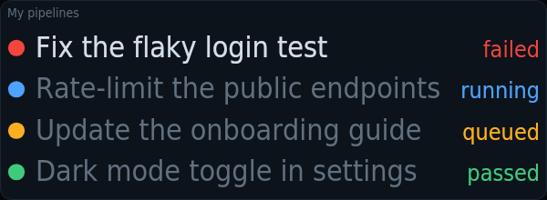
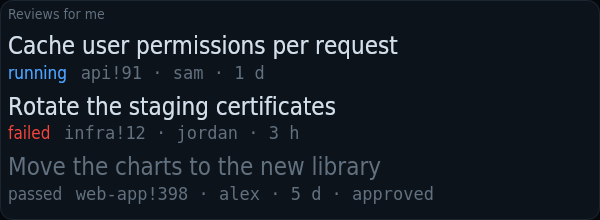

# kiosko-plugin-gitlab

Your merge requests' pipelines and the reviews waiting for you.

A plugin for [Kiosko](https://github.com/kiosko-lcd/kiosko), the widget mosaic for small USB LCD panels.



## Install

In Kiosko, **Plugins → Install from npm** → `kiosko-plugin-gitlab`, then restart Kiosko. Or from a terminal:

```sh
npm install --prefix ~/.config/kiosko/plugins kiosko-plugin-gitlab
```

(macOS: `~/Library/Application Support/Kiosko/plugins`, Windows: `%APPDATA%\Kiosko\plugins`.)

## Requirements

- [`glab`](https://gitlab.com/gitlab-org/cli) logged in, or a personal access token with `read_api` in the source options.

## Widgets

### My pipelines — `gitlab/pipelines`

The pipeline of each of your open merge requests: broken first, then running and queued, passing last.


Uses: `gitlab/merge-requests`.

| Option | Type | Default | |
|---|---|---|---|
| `includeDrafts` | boolean | `false` | Include drafts |
| `aliases` | map | `{}` | Short project names. Project (as in its path) → what to show, e.g. web-frontend → web. |

### Reviews for me — `gitlab/reviews`

Merge requests waiting for your review: whose, how long they have waited and how their pipeline is doing. The ones you approved sink, dimmed.



Uses: `gitlab/merge-requests`.

| Option | Type | Default | |
|---|---|---|---|
| `includeDrafts` | boolean | `false` | Include drafts |
| `hideApproved` | boolean | `false` | Hide the ones I approved |
| `aliases` | map | `{}` | Short project names. Project (as in its path) → what to show, e.g. web-frontend → web. |

## Data sources

### GitLab merge requests — `gitlab/merge-requests`

Your open merge requests and the ones you are asked to review, through glab or a token. Read every 3 min while a widget uses it. Options are set once in Kiosko → Settings → Data sources.

| Option | Type | Default | |
|---|---|---|---|
| `host` | string | `""` | GitLab host. Empty = glab's default host (gitlab.com with a token). |
| `token` | string | *(secret)* | Access token. A personal access token with read_api. Empty = use the glab CLI and its login. |
| `bin` | string | `"glab"` | glab command |

## Development

```sh
npm install
npm test          # node:test
npm run check     # TypeScript
npm run build     # dist/index.js, what Kiosko loads
```

To try it in a running Kiosko without publishing: `kiosko plugins link .` and restart Kiosko.

Working on Kiosko and its plugins together: clone them side by side
(`kiosko/` and `kiosko-plugins/kiosko-plugin-gitlab/`) and run `npm install` in
`kiosko/`; its workspaces link every plugin found in `../kiosko-plugins`.

## License

MIT
